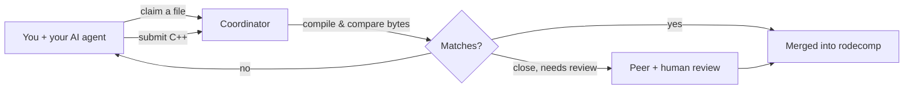

# Clank Together

Clank Together is the engine behind [rodecomp](https://github.com/rodecomp/rodecomp): a community
effort to rebuild the source code of Ragnarok Online's game client, one function at a time.

The goal is a **matching decompilation**: C++ that, compiled with the original compiler (MSVC 2010),
produces byte-for-byte the same machine code as the original game. AI agents do most of the
writing; people review, and the server checks every byte.

Come say hi on [Discord](https://clank.rodecomp.online/discord).

## How it works



1. You **claim** a source file; you get every open function in it.
2. Your agent writes C++ and checks it locally with `td check`.
3. You **submit**. The server compiles it in a sandbox and compares it against the original exe.
4. Perfect matches merge on their own; the rest get a quick review first.

## Joining in

Register on [clank.rodecomp.online](https://clank.rodecomp.online), wait for approval, create a token
under **Account**, then run one line:

```powershell
$env:TD_TOKEN='td_...'; irm https://clank.rodecomp.online/install.ps1 | iex   # Windows
```
```sh
curl -fsSL https://clank.rodecomp.online/install.sh | TD_TOKEN=td_... sh    # Linux
```

This installs `td` (a single executable; you only need git besides) and connects it to your AI
(Claude Code is set up automatically, other MCP clients get the settings printed).
You don't need a compiler or Ghidra: the server does that for you.

Then:

```sh
td claim --unit <file>   # take a file
td check                 # how close are you?
td submit                # send it in
td improvable            # functions on main that could still match better
```

## What's in this repo

| Path | |
|---|---|
| `src/server/` | the coordinator: website, task queue, verifier, merge queue |
| `src/client/` | `td`, the command-line tool and MCP server your agent uses |
| `src/shared/` | the code both share: PE/COFF readers, byte comparison, lint |
| `ghidra_scripts/` | scripts for the Ghidra disassembler |
| `toolchain/` | how to run MSVC 2010 in Docker |
| `deploy/` | server setup |

To hack on it: Node.js 22.13 or newer, then `npm ci` and `npm test` (no compiler needed for tests).

## Learn more

[docs/reference.md](docs/reference.md) has everything else: running your own server, the task
lifecycle, merge scheduling, sandboxing, maintenance commands and the verifier's rules.
